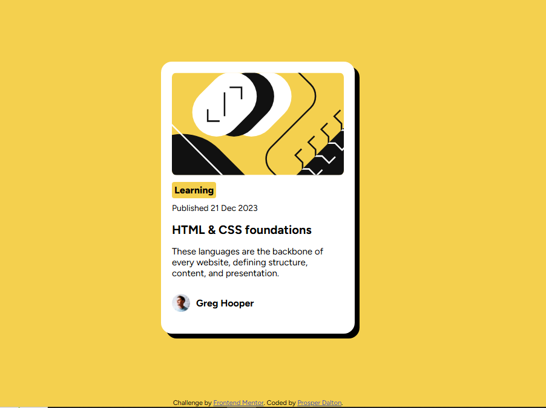

## Table of contents

- [The challenge](#the-challenge)
- [Screenshot](#screenshot)
- [Links](#links)
- [My process](#my-process)
  - [Built with](#built-with)
  - [What I learned](#what-i-learned)
  - [AI Collaboration](#ai-collaboration)
- [Author](#author)

### The challenge

Users should be able to:

- See hover and focus states for all interactive elements on the page

### Screenshot

### Links

- Solution URL: (https://github.com/daltonstrawk-maker/blog-preview-card.git)
- Live Site URL:(https://your-live-site-url.com)

## My process

-I downloaded my starter files from the frontend mentor platform that i later on worked with. These included the html file, the designs and images to use for the project.

-I used a bit of Ai to do some stuff which were the least of all and i handled most of the project all by my self.

- I used html semantics and css mainly inorder to come up with this solution

### Built with

- Semantic HTML5 markup
- CSS custom properties
- Flexbox

### What I learned

- I learned to to add shadows to my card which was the most satisfying thing i have encountered during this project

-I also learned how to add hover transtions and also make text active on hover

### Continued development

- I would really want to continue practicing with the transitions and also practice alot more about box-shadows

### AI Collaboration

Ai tools i colaborated with;
-Chatgpt

How i did;

- I used Chatgpt mainly for brainstorming, and also helping me do some learning where new staff were indroduced

## Author

- Website - [Dalton Prosper](https://github.com/daltonstrawk-maker)
- Frontend Mentor - [@daltonprosper](https://www.frontendmentor.io/profile/daltonstrawk-maker)
